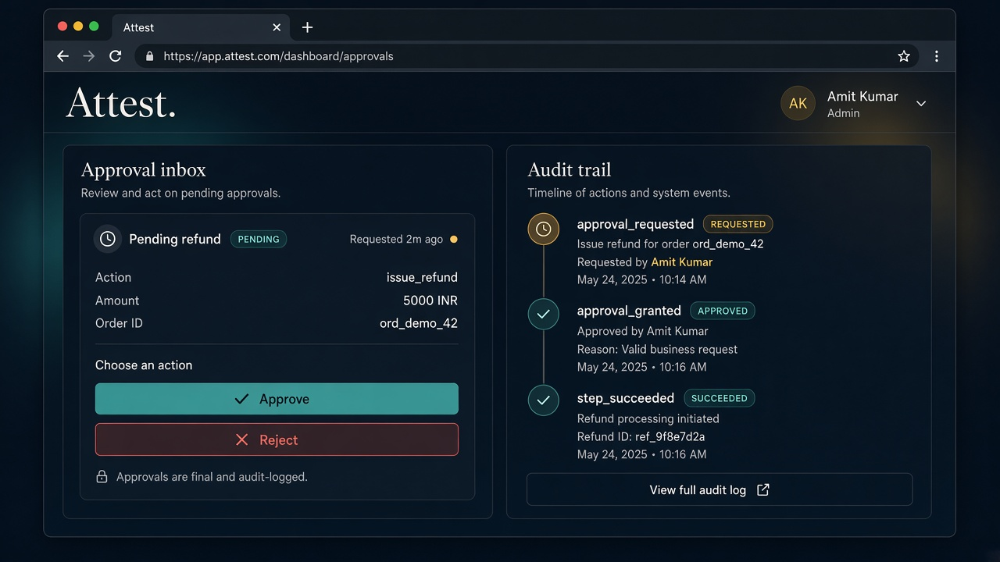

# Attest

**Approve irreversible AI tool calls — once.**

Attest is a small production-style backend that sits between an AI agent and side-effecting tools (refunds, deletes, payouts). Agents submit runs with an **idempotency key**. Safe tools execute immediately. Irreversible tools wait in a human **approval inbox**. A Postgres-backed worker claims jobs with `FOR UPDATE SKIP LOCKED`, retries with backoff, and writes an append-only audit timeline.

Built to be **resume-worthy**: Go + PostgreSQL, durable jobs, auth that looks like production, Docker Compose demo, and a real UI — not a notebook.



---

## Why this project exists

Teams are shipping AI agents that call tools. The hard part is rarely the model — it is:

1. **Not running a refund twice** when the agent retries
2. **Not losing work** when a worker process restarts
3. **Getting a human in the loop** before irreversible actions
4. **Proving what happened** with an audit trail

Attest makes those four problems visible in a 60-second demo.

---

## Architecture

```
Agent (X-API-Key) ──► API (Go / chi)
                         │
                         ▼
                    PostgreSQL 16
              (runs · steps · approvals · jobs · events)
                         ▲
                         │ SKIP LOCKED claim
                      Worker (Go)
                         │
                         ▼
                 Mock tools (refund / email)

Human (JWT) ──► Next.js inbox ──► API approve/reject
```

| Piece | Role |
| --- | --- |
| `cmd/api` | HTTP API, auth, run create, approvals |
| `cmd/worker` | Job poller + mock tool execution |
| Postgres | Source of truth for runs, jobs, audit events |
| `web/` | Approval inbox UI |

**Design choices worth calling out in interviews**

- Idempotency uniqueness is `(workspace_id, idempotency_key)` — duplicates return the original run (`replayed: true`)
- Jobs live in Postgres next to business rows (no Kafka for v1)
- Expired leases are requeued so a crashed worker cannot strand a step
- Irreversible tools always require approval; approve enqueues the job in the same transaction as the decision
- API keys and refresh tokens are stored as SHA-256 hashes only

---

## Tech stack

| Layer | Choice |
| --- | --- |
| API / worker | Go 1.22+, chi, pgx |
| Database | PostgreSQL 16 |
| Auth | Argon2id passwords, JWT access tokens, rotating refresh tokens, hashed API keys |
| Queue | Postgres `FOR UPDATE SKIP LOCKED` |
| UI | Next.js 14 + TypeScript |
| Local runtime | Docker Compose |

---

## Quick start (Docker — recommended)

### Prerequisites

- Docker Desktop (or Docker Engine + Compose v2)
- A free port on `3000` (UI) and `8080` (API)

### Step-by-step

1. **Clone the repo**

```bash
git clone https://github.com/keerthanahl16/attest.git
cd attest
```

2. **Start the stack**

```bash
docker compose up --build -d
```

This starts Postgres, the API (runs migrations + seeds demo data), the worker, and the web UI.

3. **Wait for health**

```bash
curl -s http://localhost:8080/healthz
# {"status":"ok"}
```

4. **Open the inbox**

Visit [http://localhost:3000](http://localhost:3000)

| Field | Value |
| --- | --- |
| Email | `demo@attest.dev` |
| Password | `AttestDemo!123` |

5. **Run the 60-second demo**

- Click **Simulate refund request** — an irreversible `issue_refund` run appears in the approval inbox. The same button also sends a **duplicate** with the same idempotency key (`replayed=true`).
- Click **Approve** — the worker executes the mock refund; status becomes `succeeded` and the timeline updates.
- Click **Fire safe email** — `send_email` skips approval and completes on its own.

6. **Stop**

```bash
docker compose down -v
```

---

## Demo credentials (seeded automatically)

| Kind | Value |
| --- | --- |
| Email | `demo@attest.dev` |
| Password | `AttestDemo!123` |
| Agent API key | `atk_demo_local_only_do_not_use_in_prod` |

> These exist only for local demos. Do not reuse them in any shared or production environment.

---

## Try the agent API with curl

After `docker compose up`:

```bash
# Create an irreversible refund run (waits for human approval)
curl -s -X POST http://localhost:8080/v1/agent/runs \
  -H 'Content-Type: application/json' \
  -H 'X-API-Key: atk_demo_local_only_do_not_use_in_prod' \
  -d '{
    "idempotency_key": "refund-ord-42",
    "tool": "issue_refund",
    "input": {
      "amount": 5000,
      "currency": "INR",
      "order_id": "ord_42",
      "reason": "Customer requested refund"
    }
  }' | jq

# Replay the same key — returns the same run, does not create a second side effect
curl -s -X POST http://localhost:8080/v1/agent/runs \
  -H 'Content-Type: application/json' \
  -H 'X-API-Key: atk_demo_local_only_do_not_use_in_prod' \
  -d '{
    "idempotency_key": "refund-ord-42",
    "tool": "issue_refund",
    "input": { "amount": 5000, "currency": "INR", "order_id": "ord_42" }
  }' | jq '.replayed'
# true
```

Approve from the UI, or via API after logging in:

```bash
# Login
TOKEN=$(curl -s -X POST http://localhost:8080/v1/auth/login \
  -H 'Content-Type: application/json' \
  -d '{"email":"demo@attest.dev","password":"AttestDemo!123"}' | jq -r .access_token)

# List workspaces + pending approvals
WS=$(curl -s http://localhost:8080/v1/workspaces -H "Authorization: Bearer $TOKEN" | jq -r .workspaces[0].id)
curl -s http://localhost:8080/v1/workspaces/$WS/approvals -H "Authorization: Bearer $TOKEN" | jq
```

---

## Local development (without rebuilding UI in Docker)

### Backend only

```bash
# Terminal 1 — Postgres
docker compose up -d postgres

# Terminal 2 — API
cp .env.example .env
go mod tidy
export $(grep -v '^#' .env | xargs)
go run ./cmd/api

# Terminal 3 — Worker
go run ./cmd/worker
```

### Frontend

```bash
cd web
npm install
NEXT_PUBLIC_API_URL=http://localhost:8080 npm run dev
```

### Tests

```bash
go test ./...
```

---

## HTTP surface (summary)

| Method | Path | Auth | Purpose |
| --- | --- | --- | --- |
| `GET` | `/healthz` | — | Liveness + DB ping |
| `POST` | `/v1/auth/signup` | — | Create user |
| `POST` | `/v1/auth/login` | — | Issue access + refresh tokens |
| `POST` | `/v1/auth/refresh` | — | Rotate refresh token |
| `GET` | `/v1/me` | JWT | Current user |
| `GET/POST` | `/v1/workspaces` | JWT | List / create workspace |
| `GET/POST` | `/v1/workspaces/:id/tools` | JWT | Tool registry |
| `POST` | `/v1/workspaces/:id/api-keys` | JWT | Mint agent API key (shown once) |
| `GET` | `/v1/workspaces/:id/runs` | JWT | List runs |
| `GET` | `/v1/workspaces/:id/runs/:runID` | JWT | Run + timeline |
| `GET` | `/v1/workspaces/:id/approvals` | JWT | Pending approvals |
| `POST` | `/v1/workspaces/:id/approvals/:id/approve` | JWT | Approve |
| `POST` | `/v1/workspaces/:id/approvals/:id/reject` | JWT | Reject |
| `POST` | `/v1/agent/runs` | API key | Create / replay run |
| `GET` | `/v1/agent/runs/:runID` | API key | Poll run status |

---

## Project layout

```
attest/
├── cmd/api            # HTTP process
├── cmd/worker         # Job worker process
├── internal/
│   ├── api            # chi routes + handlers
│   ├── auth           # Argon2id + JWT + token hashing
│   ├── config         # env config
│   ├── db             # pool + migrations
│   ├── seed           # demo workspace bootstrap
│   ├── store          # Postgres persistence
│   ├── tools          # mock refund / email handlers
│   └── worker         # claim → execute → succeed/retry
├── migrations/        # SQL schema (embedded)
├── web/               # Next.js approval inbox
├── docker-compose.yml
└── Dockerfile
```

---

## What a reviewer should notice

- **Plan-like clarity without overbuilding** — one database, two processes, clear package boundaries
- **Idempotency and leases** — the failure modes that matter in production backends
- **Human approval as a first-class state**, not a UI afterthought
- **Audit events** that make the system explainable in an interview

---

## Roadmap (intentionally not in v1)

- Real outbound signed webhooks to merchant systems
- Multi-step runs with DAG dependencies
- Hosted deploy (Fly.io / Railway) + CI badge
- OpenAPI export and generated clients

---

## License

MIT — see [LICENSE](LICENSE).

---

Built by [keerthanahl16](https://github.com/keerthanahl16) as a portfolio backend project (Go · PostgreSQL · durable workers · approval UX).
